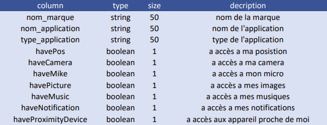
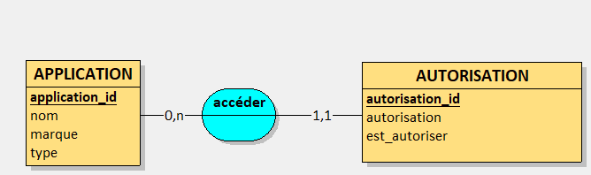
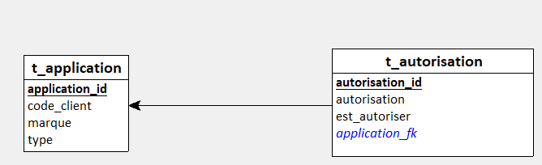
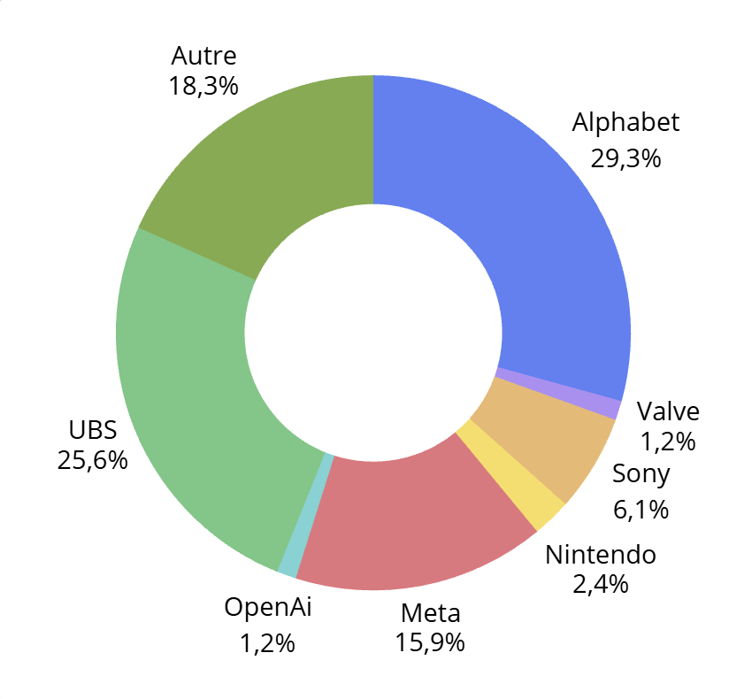
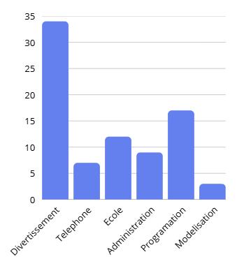
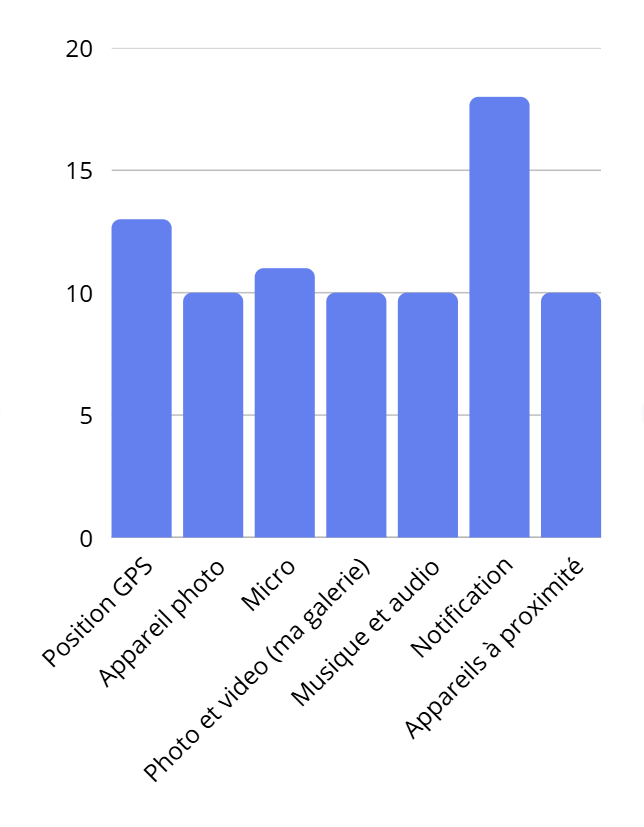

<h1>

**Bahloul Amazigh**

**MIN1B**

**Titre**

**Analyse de son empreinte numérique et des traces laissées.**

**05.10.26**

</h1>

<!-- **Introduction :**

Tous les jours, nous donnons des centaines de donnée sur nous, notre mode de vie, notre localisation, nos préférences et notre entourage sans nous en rentre compte. Pendant un mois, je vais tracer mon empreinte numérique pour voir toutes les données que je laisse sur moi. -->

# Pourquoi ce thème ?

J'ai voulu partir sur ce thème car je voulais en savoir plus sur que j'utilise dans ma vie mais surtout, quelle information les applications et sites que j'utilise ont sur moi.

# Thème, Source et Objectif

Comme dit lors de la partie "Pourquoi ce thème ?" Mon objectif est d'analyser les informations qu'ont les sites et applications que j'utilise dans ma vie.

Les source que j'utiliserai lors de ce rapport sont :

- L'application Paramètre de mon téléphone

- Mon historique Google

- 

Pour ce faire, je vais me poser cinque questions auquelle nous allons répondre plus tard dans ce rapport :

1. Quelle information sont prise sur moi ?

2. Quelle groupe / marque a le plus d'information sur moi ?

3. Quelle “type” d’application / site ai je le plus ?

4. Combien de services numériques différents est-ce que j’utilise ?

5. Quelle autorisation je donne le moins sur moi ?

# Collecte des données

Toutes les informations que je récolterai seront les sites et les applications que je consulte régulièrement, pour chaque site web consulter depuis mon téléphone, je prendrai toutes les autorisations que mon téléphone me propose à savoir : 

- Position

- Appareil photo

- Micro

- Photo et video (ma galerie)

- Musique et audio

- Notification

- Appareils à proximité

Pour les applications installer sur mon téléphone, je prendrai les mêmes autorisations que cité pour les sites web consulter depuis mon téléphone pour des raisons de simplification des données et paracerque mon téléphone me permet de voir les autorisations données par les mêmes autorisations.

Pour les sites et les applications consulter et installer sur mon ordinateur, je considèrerai aussi que ce sont les mêmes autorisations et pour des raisons semblables à celle cité plus haut.

J'ai collecté ce premier jeu de donnée du 03.09.2026 au 24.09.2026 soie en trois semaines, ces données seront au format JSON et présenter sur une page HTML appeler "tableau.html"

Les données ne concernent que moi, je n'ai pas pris de mesure particulière pour anonymiser mes données.

Pour contrôler la validité de mes informations, je prendrai toute mes applications et une partie de mon historique en capture d'écran pour toutes les données puisse être vérifier.

# Première analyse :

Mon tout premier jeu de données étais à 

Une liste d'objets qui ressembler à :

```JSON
{ 

    "nom_marque": { 

      "nom": "nom_application", 

      "type": "Type_application", 

      "aUnMotDePasse": true ou false, 

      "aUneAdressEmail": true ou false

    }	

  }
```

Puis je me suis vite rendu compte que mes objets n'avaient pas assez de propriété, je suis donc passé à des objets ressemblent à : 

```JSON
{

    "name": "Nom_marque",

    " Nom_marque ": [

      {

        "name": "Nom_application",

        "type": "Type application",

        "havePos": true ou false,

        "haveCamera": true ou false,

        "haveMike": true ou false,

        "havePicture": true ou false,

        "haveMusic": true ou false,

        "haveNotification": true ou false,

        "haveProximityDevice": true ou false

      }

    ]

  }
  ```

Nous pouvons vite voir que cet objet à bien plus de propriété qui sont de type booléen et quelques-uns qui sont des chaines de caractère comme le nom de la marque, de l'application et le type d'application. Cet objet fonctionne mais j'ai eu un problème avec Alphabet car Alphabet content Google qui contient les applications à ajouter, il y a donc trois "couches" alors que les autres marques n'ont que deux "couches" d'objets

<!-- # Amélioration et structuration des données -->

# MCD / MLD 

Passons maintenant aux MCD / MLD que j'ai fait et leur dictionnaire :
<br>
<br>
<br>




<br>
le MLD possède deux tables (t_application et t_autorisation) et une fk (application_fk)

# 6. Analyse des données

je vais maintenant répondre aux questions posé plus haut:
<h3><strong>6.1 Quelle information sont prise sur moi ?</strong></h3>

<h4>Méthode utilisée</h4>
pour le savoir, je peut me réferer au point Collecte des données
<h4>Résultat</h4>
on y a établie que les autorisations que nous prendrerons serrons: Position, Appareil photo, Micro, Photo/video (ma galerie), Musique et audio, Notification, Appareils à proximité
<!-- <h4>Interprétation</h4> -->


<h3><strong>6.2 Quelle groupe / marque a le plus d'information sur moi ?</strong></h3>

<h4>Méthode utilisée</h4>
je vais prendre la somme des autorisations des différant groupe / marque et mettre les résultat sous forme de graphique circulaire

<h4>Résultat</h4>
le graphique circulaire ressemble à:
<br>



<h4>Interprétation</h4>
<!-- ajouter phrase graphique -->

<h3><strong>6.3 Quelle “type” d’application / site ai je le plus ?</strong></h3>

<h4>Méthode utilisée</h4>
j'ai crée un script de 20 lignes qui me donne le résultat suivant:

<h4>Résultat</h4>



<h4>Interprétation</h4>
l'ordre des trois premiers est divertissement, programmation et école, probablement car c'est mes centre d'intérêt. 

<h3><strong>6.4 Combien de services numériques différents est-ce que j’utilise ?</strong></h3>

<h4>Méthode utilisée</h4>
cette information est donnée en bas de mon tableau

<h4>Résultat</h4>

54 application + 28 site = 82 services numériques différents.

<h4>Interprétation</h4>

<h3><strong>6.5 Quelle autorisation je donne le moins sur moi ?</strong></h3>

<h4>Méthode utilisée</h4>
j'ai compter et trouvé:

<h4>Résultat</h4>



<h4>Interprétation</h4>

appareil photo, galerie, Musique et appareils à proximité sont les quatre plus bas avec un score de 10, je suppose que se sont quatre autorisations que je donne plus difficilement et donc aux même applications en qui j'ai confiance.

# 8. Synthèse des résultats
grâce à ce projet, j'ai pu mieux voir les principal informations que les applications que j'utilise ont sur moi et, aujourd'hui, j'accepte moins facilement lors ce qu'une application veut accédé à mes notifications, ma galerie, etc.

# 9. Conclusion
**9.1 Bilan**
je remarque que, bien que je trouve déjà accepter trop, il y a bien plus de "oui" que de "non" ( 82 "oui pour 296 "non" ) ce qui pourrais s'expliqué par le fait que mon téléphone ne me demande seulement lorsque ça sert vraiment et mets le reste des autorisations en "non" (=> false) combiner au fait que je refuse plus facilement que j'accepte.

**9.2 Difficultés rencontrées**


**9.3 Améliorations possibles**


# Annexes


